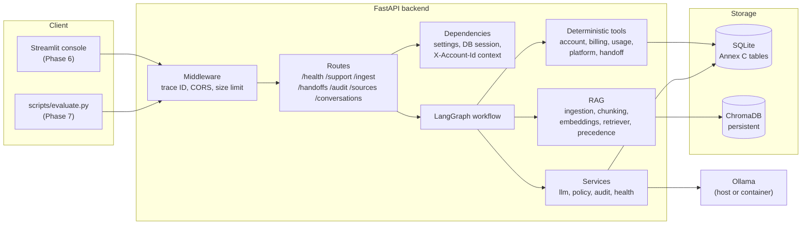
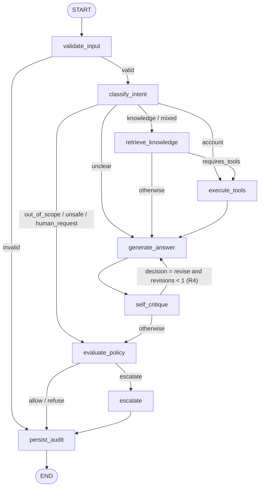
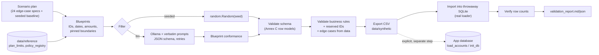
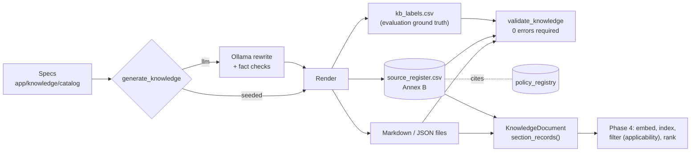

# InsightDesk Architecture

InsightDesk is an agentic customer-support backend. A FastAPI service fronts a
LangGraph workflow that combines version-aware retrieval (ChromaDB), deterministic
account tools (SQLite), a local LLM (Ollama), a self-critique loop, rule-based
escalation and a full audit trail.

> **Status:** Phase 3 (knowledge base and source register) complete. Boxes marked
> *(Phase N)* exist as interfaces only. They raise an explicit `NotImplemented`
> error rather than returning placeholder output. The authoritative
> requirements are in the participant guide
> ([transcription](reference/guide_extract.md)).

## System overview

## Request lifecycle

1. **`TraceIdMiddleware`** assigns a trace ID: it reuses a well-formed inbound
   `X-Trace-Id` or generates a new UUID4 hex. The ID is stored in a context
   variable, so every log line carries it, and it is returned in the
   `X-Trace-Id` response header. This middleware is also the last-resort
   handler that turns unexpected exceptions into a structured 500.
2. **`CORSMiddleware`** allows the Streamlit origin(s) from `CORS_ORIGINS`.
3. **`RequestSizeLimitMiddleware`** rejects bodies over `MAX_REQUEST_BYTES`
   with a 413, both with and without a `Content-Length` header.
4. **Pydantic validation** checks the request body. `message` is limited to
   1–4000 characters after whitespace is stripped.
5. **Account context (R8).** Only the `X-Account-Id` header is used. It is
   validated against `^[A-Za-z0-9][A-Za-z0-9_-]{0,63}$`, and a malformed value
   gets a 400. There is no body field for it. This is *declared context, not
   authentication*. Tools receive this `AccountContext`, never an ID parsed
   from message text or produced by the LLM.
6. **Route handler.** In Phase 1, `/support` stops here with a 501.
7. **Exception handlers** emit the standard error envelope:
   `{"error": {"code", "message", "details"}, "trace_id"}`. Validation errors
   are sanitised so they never echo rejected input.

## Agent graph

Defined in `backend/app/agents/graph.py`. Routing functions are deterministic
and read only state. Nodes make all decisions: the LLM handles intent and
critique, and rules handle policy.

| Node | Phase | Reads | Writes |
|---|---|---|---|
| `validate_input` | **1 (implemented)** | message, request | input_valid, validation_errors |
| `classify_intent` | 4 | message, customer | intent |
| `retrieve_knowledge` | 3 | message, intent, as_of_date | retrieved_documents, conflicts_detected |
| `execute_tools` | 4 | intent, customer (validated) | tool_results, tools_invoked |
| `generate_answer` | 4 | docs, tool results, critic feedback | draft_answer, answer_type, citations, revision_count (on a revision) |
| `self_critique` | 4 | draft, citations, evidence | critic_feedback (+): `CriticReport` with groundedness, coverage, pii_risk, policy_risk, decision |
| `evaluate_policy` | 5 | intent, draft, critic, tools | policy_decision, applied_policy_ids, escalation_reasons (+) |
| `escalate` | 5 | escalation_reasons, context | handoff, answer_type=escalated |
| `persist_audit` | 5 | entire state | audit_persisted |

`(+)` marks fields with an `operator.add` reducer, which accumulate across nodes.
Every node is wrapped by `audited_node`, which appends an `AuditEvent` with
timing and outcome, so audit coverage doesn't depend on each node doing it
itself.

### Answer-type mapping (planned)

| `answer_type` | Produced when |
|---|---|
| `answered` | Critic passes and policy allows |
| `clarification_needed` | Intent `unclear`, or account context is missing for an account question |
| `escalated` | Policy escalates. `handoff_id` is required (enforced by the schema) |
| `not_found` | No eligible evidence was retrieved and no tool data applies |
| `refused` | Intent `unsafe` or a policy refusal rule fires |
| `out_of_scope` | Intent `out_of_scope` |

## Persistence and data

* **SQLite via SQLAlchemy 2.x.** `PRAGMA foreign_keys=ON` is set on every
  connection. `Database.session_scope()` and the `get_db_session` dependency
  commit on success and roll back on error.
* **The Annex C schema is implemented exactly**: seven tables with the guide's
  column names, TEXT/INTEGER/REAL types, PKs and FKs, plus CHECK constraints
  for the rules Annex C states. `app/database/annex_c.py` holds an independent
  transcription, and `verify_schema()` checks the live database against it at
  startup, in `/health`, in `init_db` and in the tests. Details:
  [database_schema.md](database_schema.md).
* **Data access:**
  * `AccountScopedRepository` is built from the request's `AccountContext`;
    no method takes an account ID.
  * `ReferenceRepository` serves plan limits and platform status.
  * `PolicyRegistryRepository` is read-only.
  * `HandoffRepository` is the only write path.
* **Startup** creates any missing tables and idempotently loads
  `data/reference` (plan limits and 23 policy rules) when
  `SEED_REFERENCE_DATA=true`.
* **ChromaDB `PersistentClient`** lives under `CHROMA_PERSIST_DIR`, with
  telemetry disabled. It is opened once in the lifespan and shared.

### Synthetic data pipeline

The **judge loader** (`scripts/load_accounts.py`) shares the row models and
the import code. For judge data, though, business-consistency rules are
warnings rather than errors, and reserved IDs are allowed.

### Knowledge base (Phase 3)

* **Content:** `data/knowledge_base/{articles,policies,release_notes,community}/*.md`
  and `data/tickets/*.json`, with metadata only in the Annex B Source Register
  (`data/source_register/source_register.csv`).
* **Single metadata standard:** `app.schemas.ingestion.SourceRegisterEntry`
  serves the register rows, the `POST /ingest` metadata and the `GET /sources`
  items.
* **`app/knowledge/`:**
  * `documents.py`: loader, plus `KnowledgeDocument` and `section_records`
    (retrieval-ready, citation fields on every section);
  * `versions.py`: `product_versions` grammar and the release timeline;
  * `precedence.py`: Annex A applicability, deprecation and supersession
    metadata;
  * `safety.py`: injection signal and untrusted-data wrapping;
  * `generator.py`: seeded and LLM rendering;
  * `validation.py`.
* Details: [knowledge_base.md](knowledge_base.md), [source_precedence.md](source_precedence.md).

### Tools

`app/tools/registry.py` holds `TOOL_SPECS` for the eight Annex C tools
(request and response models, account scoping, tables read and written).
`invoke_tool` is the only call path:

1. Validate the arguments; unknown fields such as `account_id` are rejected.
2. Enforce the account context.
3. Run the tool.
4. Validate its output.
5. Turn any failure into a structured error, never fabricated data.

Business logic: Phase 5.

## Health semantics

| Status | Meaning |
|---|---|
| `healthy` | A live probe succeeded at request time (SQLite `SELECT 1` with FKs on, Chroma heartbeat, Ollama `/api/tags` listing the configured model) |
| `unavailable` | Configured, but the probe failed: server down, timeout, HTTP error, or init failure |
| `not_configured` | Setting blank, or a setup step is missing (Ollama is reachable but `OLLAMA_MODEL` hasn't been pulled) |

The overall status is `ok` only if all components are healthy, and `degraded`
otherwise. `/health` always returns HTTP 200. `/health/live` is a dependency-free
liveness probe used by the Docker `HEALTHCHECK`.

## Security & responsible-AI foundations

* No authentication in the prototype. `X-Account-Id` is explicitly *not*
  proof of identity (`AccountContext.verified` is always `False`), and it is
  the **only** source of the account (R8).
* Account tools take the validated `AccountContext`. Their request models
  forbid an `account_id` argument, so the LLM can't choose which account to
  read.
* **Knowledge documents are data, not instructions** (R10). No retrieved
  document can modify policies or thresholds, alter the system prompt, reveal
  secrets, change account identity or execute tools:
  * policy values come only from the registry;
  * identity comes only from the header;
  * tools run only through `invoke_tool`;
  * document text enters prompts only through `as_untrusted_data()`, a
    delimited block the content cannot close.

  The rationale and tests are in [source_precedence.md](source_precedence.md#knowledge-is-data-not-instructions).
* Refunds, credits and account changes are never executed. Only
  `create_handoff` writes, and only to `handoffs`. `send_password_reset`
  results can't carry a token or link. The policy registry is read-only at
  runtime.
* Logs are structured JSON with redaction:
  * sensitive keys (`message`, `account_id`, `password`, `*token`, …) are
    dropped;
  * emails, phone numbers, card-like numbers, bearer tokens and `key=value`
    secrets are masked in messages and tracebacks;
  * Uvicorn's access log is disabled (it records query strings), and request
    logs record method, path, status and duration only.
* Error responses never echo submitted values. Configuration errors name the
  field but not the value.
* Request bodies are bounded (`MAX_REQUEST_BYTES`) and messages are capped at
  4000 characters.

## Deployment topology

* **Local:** run `uvicorn` from `backend/`, with Ollama on the host.
* **Docker Compose:** the `backend` container mounts `./data` at `/app/data`
  (SQLite, Chroma and the Hugging Face cache) and reaches host Ollama through
  `host.docker.internal`. The optional `ollama` profile runs Ollama in a
  container with a named volume for models.

## Files added beyond the prescribed layout

| File | Why |
|---|---|
| `backend/app/core/middleware.py` | Pure-ASGI trace-ID and size-limit middleware. Pure ASGI keeps the context variable reliable and allows a structured 500 that carries the trace header |
| `backend/app/core/lifecycle.py` | Owns long-lived resources (engine, Chroma client, Ollama client) for the lifespan, which keeps `main.py` small |
| `backend/app/services/health.py` | Component probes, kept out of the route module so they can be tested and reused |
| `backend/app/rag/vector_store.py` | A single place to open the Chroma client, shared by health checks now and by the retriever and ingestion later |
| `backend/app/schemas/common.py`, `schemas/health.py` | Error envelope and health models |
| `backend/app/agents/nodes/base.py` | Node protocol, `NodeNotImplementedError`, `audited_node` decorator |
| `backend/app/database/repositories/base.py` | Repository base class (no commits inside repositories) |
| `backend/app/utils/time.py` | UTC helpers |
| `backend/pyproject.toml` | pytest configuration (`pythonpath`, `testpaths`) |
| `backend/requirements-dev.txt` | Test-only dependencies kept out of the runtime image |
| `backend/.dockerignore` | Keeps tests, caches and local DBs out of the image |
| **Phase 2** | |
| `backend/app/database/annex_c.py` | Independent Annex C transcription and `verify_schema()`, so schema drift is caught |
| `backend/app/database/row_schemas.py` | One Pydantic model per table: the single source of row rules for the generator, validator and loader |
| `backend/app/database/validation.py` | Schema, referential, business and reserved-ID checks with stable rule codes |
| `backend/app/database/csv_io.py`, `init_db.py` | Judge loader, deterministic export and idempotent initialisation |
| `backend/app/database/repositories/accounts.py`, `policy_registry.py` | Account-scoped and read-only access |
| `backend/app/synthetic/` | Scenario plan, blueprints, seeded and LLM fillers, edge-case verification, pipeline |
| `backend/app/cli/` | CLI entry points (also usable inside the container), wrapped by `scripts/*.py` |
| `backend/app/tools/base.py`, `registry.py` | Tool context, errors, specs and the dispatcher |
| `data/reference/`, `data/synthetic/prompts/` | Hand-authored reference data and verbatim LLM prompts |
| `docs/reference/guide_extract.md` | Searchable transcription of the photographed participant guide |
